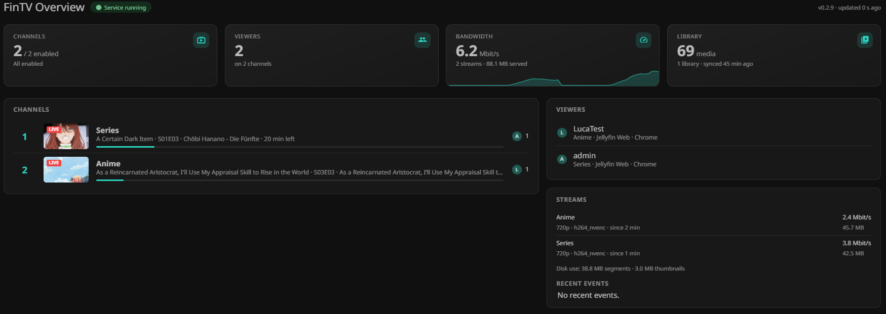

# SolidProgramming – Unraid Templates

Community Applications templates for Unraid maintained by **SolidProgramming**.

| App | Description | Source |
| --- | --- | --- |
| [FinTV](#fintv) | Virtual 24/7 TV channels from your Jellyfin library | Closed source |
| [GlanceRiff](#glanceriff) | Lightweight system monitor with web dashboard and JSON API | [GitHub](https://github.com/SolidProgramming/GlanceRiff) |

## Installation

1. Open **Community Applications** in Unraid.
2. Search for the app, for example **FinTV** or **GlanceRiff**.
3. Select the template and click Install.
4. Check the settings (see the app's section below) and start the container.

## FinTV

[Screenshots](docs/screenshots/screenshots.md)

FinTV creates virtual 24/7 TV channels from your Jellyfin media library and provides them as HLS streams.

The FinTV container also provides the Jellyfin plugin repository, allowing you to install and manage the plugin directly through Jellyfin.

**Features:**

- Create virtual 24/7 TV channels from your Jellyfin library
- HLS streaming support
- Jellyfin plugin integration
- Configurable media path mappings
- CPU encoding with `libx264`
- Optional NVIDIA NVENC hardware acceleration
- Configurable API authentication
- Persistent configuration and database storage

**Requirements:**

- A running Jellyfin server
- Access to the media directories used by Jellyfin
- NVIDIA GPU and the Unraid Nvidia Driver plugin (optional, for NVENC encoding)

**Setup:** Set the media path, start the container and follow the setup steps in the template's description to install and connect the Jellyfin plugin.

The FinTV application source code is not publicly available. For questions and bug reports, [open an issue in this repository](https://github.com/SolidProgramming/UnraidTemplates/issues).

## GlanceRiff

GlanceRiff is a lightweight, glances-style system monitor with a web dashboard and JSON API.

**Features:**

- CPU, memory, disks, network, temperatures and processes
- History graphs for the last 10 minutes
- Optional login and API token

**Setup:** The defaults work as they are. The container runs on the host network and sees the host's processes (`--pid=host`), so the dashboard shows the Unraid server, not the container. It is then at `http://[IP]:61208`. Set a username and password if the dashboard should not be open to everyone on your network.

Source code, questions and bug reports: [GlanceRiff on GitHub](https://github.com/SolidProgramming/GlanceRiff).

## License

The templates in this repository are provided under the MIT License, unless otherwise specified.

---

Maintained by **SolidProgramming**.
